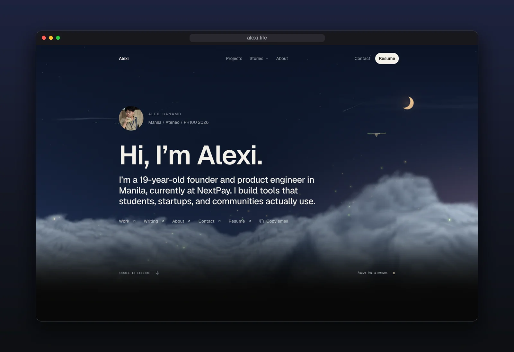
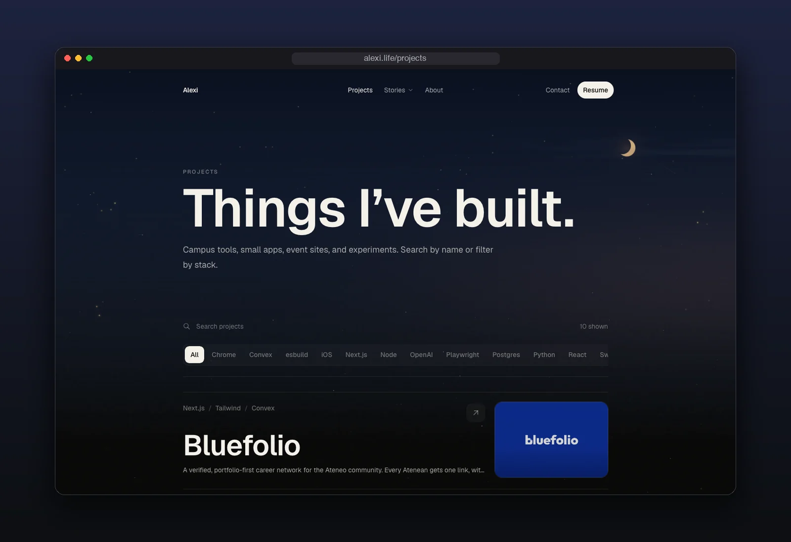
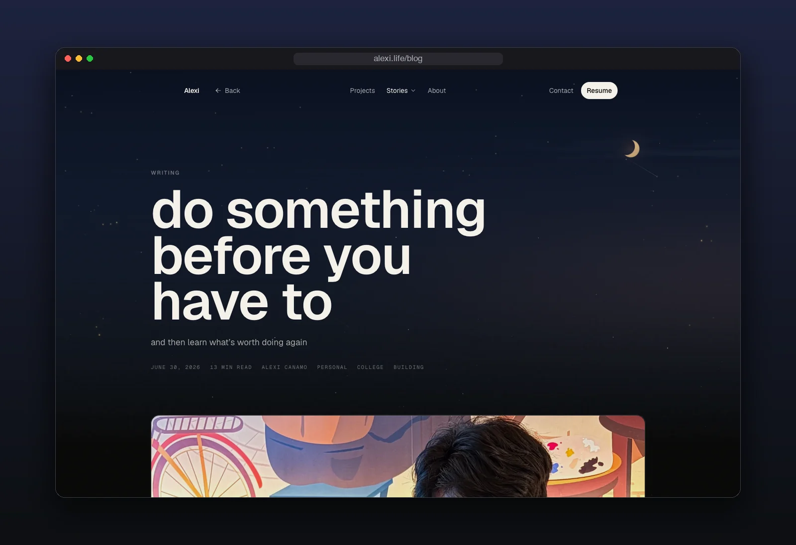
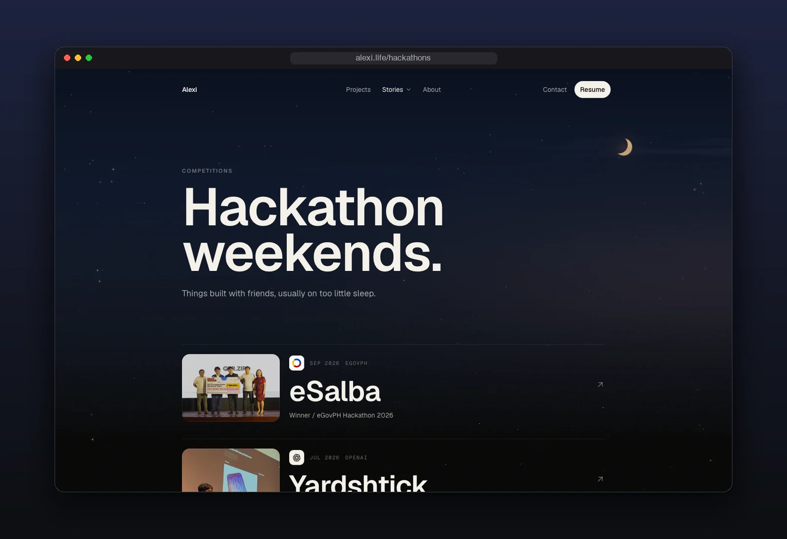

<div align="center">

<br>

# alexi.life

**My corner of the internet.**

Projects, writing, talks, and hackathons, under a moonlit sky.

<a href="https://alexi.life">alexi.life</a> ·
<a href="#whats-inside">What's inside</a> ·
<a href="#run-it-locally">Run it locally</a>

<br>


<br>



</div>

<br>

<table>
<tr>
<td width="33%"></td>
<td width="33%"></td>
<td width="33%"></td>
</tr>
<tr>
<td align="center"><sub>projects</sub></td>
<td align="center"><sub>writing</sub></td>
<td align="center"><sub>hackathons</sub></td>
</tr>
</table>

<br>

## What's inside

- **A night sky.** The hero is a moonlit scene with clouds and a passing plane, drawn in Three.js.
- **Content as files.** Projects, posts, talks and hackathons are markdown in `src/content`. Drafts stay hidden with `draft: true`.
- **A timeline.** The longer trail on the home page is built from `src/data/experience.json`.
- **Share cards.** Every page gets its own Open Graph image, plus a generated sitemap.

<br>

## Run it locally

Next.js 16 · React 19 · Tailwind CSS 4 · Motion · Three.js · Biome

<details>
<summary><b>Setup</b></summary>
<br>

```bash
npm install
npm run dev
```

Adding a project, post or hackathon is a new markdown file in `src/content/`.

</details>

<br>

<div align="center">
<sub>made in manila</sub>
</div>
